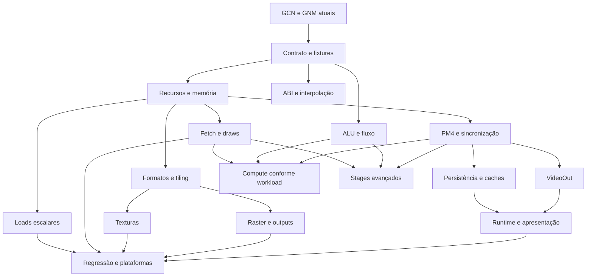

# Fase 4 PS4 — pendências, partes e dependências

Atualização 2026-11-08: [IMAGE_LOAD RGBA8 e recursos VS/PS simultâneos](PS4_TEXTURES.md) validados: até dois buffers e uma textura por estágio, ELF com seis payloads, 25/25 testes, Vulkan/D3D12/WARP e build UWP aprovados. Samplers/filtragem, demais formatos/tiling e fase 4 geral permanecem incompletos.

Atualização 2026-11-08: [MUBUF indexado, dois buffers e vertex fetch](PS4_MUBUF.md) implementados e validados no contrato limitado: 24/24 testes, ELF guest com índice/dados mutáveis, Vulkan/D3D12/WARP e build UWP aprovados. Texturas/MIMG, buffers simultâneos VS+PS e a fase 4 geral continuam incompletos.

Atualização 2026-11-08: [interpolação e cobertura GCN](PS4_GCN_COVERAGE.md): mapa smooth PARAM e interpolação linear central integrados ao GNM; sete VOP1 adicionais exercitadas com buffer GPU real. 23/23 testes, Vulkan/D3D12/WARP e build UWP aprovados nos níveis documentados. Todas as famílias GCN e a fase 4 continuam incompletas.

Atualização 2026-11-08: [descriptor e SMRD com buffer GPU real](PS4_GCN_BUFFERS.md) validados no contrato inicial de um buffer read-only no PS, com offset imediato. ELF guest altera os dados entre submissões; 23/23 testes, probes Vulkan/D3D12/WARP e build UWP aprovados nos níveis documentados. P1/P2 gerais e fase 4 continuam parciais.

Atualização posterior a este snapshot: [incremento de transferências GNM concluído](PS4_GNM_TRANSFERS.md) conecta o subconjunto WRITE_DATA/DMA_DATA aos draws em alvos atuais, com 22/22 testes aprovados. As menções abaixo a transferências isoladas descrevem o estado anterior; P9 geral (sincronização/engines/comandos) e as demais partes continuam abertas.

Data: **2026-11-08**. Base Git: `0c4c06507116ae3ff2cdb95ffdb4a5351dc1d718`, **com alterações locais acumuladas**. O commit sozinho não reproduz o estado analisado. Este ciclo é documental: inspeção do código e leitura de logs existentes, sem novos builds/testes de execução, instalações ou deploy.

## 1. Conclusão e critério de fechamento

**Já existe ELF AMD64 → imports GNM → PM4 → GCN → GPU → framebuffer guest. Falta transformar esse caminho limitado em execução gráfica com recursos gerais, sincronização e apresentação contínua pela aplicação.** Frontend GCN, GNM limitado, interpolação e D3D12 já existem; não devem voltar à lista como inteiramente ausentes.

A especificação exige teste gráfico verificável, preservação PS5 e caminho UWP/D3D12 compilável, exercitado quando houver hardware. Esse marco diagnóstico tem evidência desktop e build UWP. A especificação não enumera cobertura completa da GPU/ISA. Por isso, distinguir:

| Marco | Estado | Fechamento |
|---|---|---|
| G0 — diagnóstico gráfico | Comprovado no subconjunto desktop; execução UWP/Xbox pendente | Preservar evidências e separar desktop, build e dispositivo |
| G1 — fase 4 operacional integrada | Pendente | Recursos e comandos do conjunto de referência, sincronização, apresentação pelo runtime e validação dos dois backends |
| G2 — cobertura GPU para jogos | Aberto por título | Todas as operações exigidas pelo título/fixture escolhido, com limitações restantes registradas |

**G1 é uma recomendação deste relatório**, mais ampla que o teste mínimo literal; não é nova exigência já aprovada nem promessa de compatibilidade comercial. Não se pode fechar “GPU PS4 completa” por uma lista arbitrária de testes sintéticos. P0 define o denominador antes de qualquer percentual ou estimativa. O catálogo cobre as áreas faltantes; o inventário exato de opcodes, formatos e exports depende do conjunto escolhido.

## 2. Base existente confirmada

| Área | Implementado/testado dentro do contrato atual |
|---|---|
| ISA | Decoder GCN próprio; ALU escalar/vetorial limitada, VOP3 F32 selecionado, SGPRs de usuário, branches escalares para frente; IR/SPIR-V compartilhados |
| VS/PS | Vertex ID em v0; até quatro PARAM completos, perspectiva central, P1/P2 adjacentes, mapa identity/smooth |
| Runtime GNM | Cinco exports: SetVsShader, SetPsShader, DrawIndexAuto, SubmitCommandBuffers, SubmitDone; sessão, thread nativa, snapshots e registro pelo linker/kernel PS4 |
| PM4 integrado | NOP, SET_SH_REG, SET_CONTEXT_REG, SET_UCONFIG_REG, NUM_INSTANCES=1, DRAW_INDEX_AUTO e allowlist de estado |
| Transferências | WRITE_DATA e DMA_DATA immediate-fill em decoder/probes separados; **não conectados ao switch da submissão GNM** |
| Raster | Triangle list, uma instância, RGBA8 linear-aligned, scissor, máscara/blend limitado e preservação do alvo; sem depth/stencil/cull |
| Hosts | Adaptadores Vulkan/D3D12; Mesa-UWP e DxilCompiler existente; renderer GNM headless com device/queue próprios, sem presenter |
| Evidências anteriores | 21/21 CTest; 12 fixtures SPIR-V mais checks de quatro slots; 18 objetos DXIL; dez cenas em D3D12 Radeon/WARP/Vulkan; ELF guest confere pixels |
| UWP | Build completo e imports aprovados nos logs; não executado em AppContainer/Xbox |

Limites atuais: shader até 4096 palavras, 16 user SGPRs, lote até 16 DCBs/4 MiB de comandos, 64 draws, alvo até 1024×1024, 16 MiB agregados de alvos. Há verificações de faixa por acesso de até 4 MiB. Aumentar esses valores exige validação; não basta remover guards.

## 3. Evidência no código

| ID | Arquivo/função | Lacuna confirmada |
|---|---|---|
| E1 | [ps4Gnm.cpp](../src/libs/ps4Gnm.cpp), PrepareDraw/SubmitOnWorker/RegisterGnmExports | Estado estreito, cinco exports, CCB não vazio recusado; sem casos de transferências/dispatch/sync no switch |
| E2 | [GcnDecoder.cpp](../src/graphics/shader/recompiler/frontend/decode/GcnDecoder.cpp), Decode | Sem famílias de memória, somente VS/PS; loops, EXEC/VCC e interpolação geral não implementados neste frontend |
| E3 | [GcnCompiler.cpp](../src/graphics/shader/recompiler/GcnCompiler.cpp), Compile | User SGPRs especializados em constantes; não fornece contrato de recursos ligado ao host; especialização de recursos inicialmente vazia |
| E4 | [ps4Raster.h](../src/graphics/guest_gpu/ps4Raster.h), [ps4GnmRenderer.h](../src/graphics/guest_gpu/ps4GnmRenderer.h) | API limitada, saída em pixels CPU, sem recurso persistente/presenter |
| E5 | src/graphics/host_gpu/{d3d12,renderer}/ps4GnmRenderer.cpp | Devices headless separados do contexto de apresentação |
| E6 | d3d12/ps4RasterProbe.cpp e renderer/ps4TransferProbe.cpp | Recursos/pipeline do probe, fence/readback por draw; root signature D3D12 só com constantes, sem tabelas de recursos de shader |
| E7 | [ps4Transfer.cpp](../src/graphics/guest_gpu/ps4Transfer.cpp), DecodeTransfers | Transferências isoladas do fluxo GNM |
| E8 | [emulator.cpp](../src/emulator.cpp), RunPs4Cpu; [guestPlatform.cpp](../src/common/guestPlatform.cpp), GuestLaunchError | Diagnóstico não inicia janela/presenter; fluxo normal recusa PS4 |
| E9 | [libVideoOut.cpp](../src/libs/libVideoOut.cpp), LibGen5; presentation/videoOut.* | Infraestrutura de host disponível; registro/estruturas atuais não equivalem a adaptador Gen4 validado |
| E10 | shader/programCache.*, caches/pipelines/schedulers/tilers dos hosts | Reuso possível a investigar, não compatibilidade GCN comprovada |

O DxilCompiler **já tem cache de traduções ligadas**. Falta integrar adequadamente cache GCN/pipelines/recursos ao caminho PS4; não falta “todo cache”. A lease atual protege lifetime de montagens do perfil, mas não prova coerência geral CPU/GPU ou snapshot atômico diante de escritas guest concorrentes.

## 4. Partes e dependências diretas

Cada parte admite incrementos menores. Testes, erros controlados e avaliação dos dois backends acompanham todas as partes, não apenas a última.

| Parte | Entrega restante | Dependências diretas |
|---|---|---|
| P0 | Contrato de fechamento e conjunto de referência | Base atual |
| P1 | Recursos, descriptors e memória guest | P0 |
| P2 | Memória escalar / constantes de shaders | P1 |
| P3 | Memória vetorial, vertex fetch e draws gerais | P1 |
| P4 | ALU, fluxo e execução por lanes | P0; P1 para scratch/memória |
| P5 | ABI VS/PS e interpolação geral | P0; P3 para teste com geometria de buffer |
| P6 | Imagens, formatos, tiling e metadados | P1 |
| P7 | Texturas, samplers e storage images | P1 + P6 |
| P8 | Rasterização, depth e outputs gerais | P1 + P6 |
| P9 | PM4, transferências integradas e sincronização | P1 |
| P10 | Compute, LDS, atomics e barreiras | P3 + P4 + P9 |
| P11 | Persistência, scheduler, coerência e caches | P1 + P9 |
| P12 | VideoOut Gen4 e apresentação | P1 + P9 |
| P13 | Runtime gráfico da aplicação | P11 + P12 |
| P14 | Fechamento da regressão/plataformas | P2 + P3 + P7 + P8 + P13 no G1 proposto |
| P15 | Stages/capacidades avançadas por título | P3 + P4 + P9; P10 se emulados por compute |

P2 não é pré-requisito matemático de todo acesso vetorial de P3: vem antes por ser incremento menor. P4/P5 podem avançar com P1/P2. Compute/GS/tessellation só bloqueiam o conjunto que os utiliza. A tabela é a referência completa; o diagrama resume os caminhos principais.

Avanço em P1/P6/P7: [IMAGE_LOAD e recursos simultâneos VS/PS](PS4_TEXTURES.md) fecha o contrato inicial de textura linear RGBA8, bindings e snapshots de seis recursos. As pendências gerais de samplers/formatos/tiling/coerência abaixo permanecem.

## 5. Entregas por parte

### P0 — Contrato de fechamento

**Falta:** escolher fixtures legais/títulos de referência e inventariar exports, pacotes, estado, ISA, formatos e stages exigidos. Definir limites e separar suporte funcional de reconhecimento.

**Pronto:** matriz exigido/implementado/testado, cena integrada de referência e classificação de cada pendência como G1, dependência de título ou expansão posterior. Sem esse denominador não há percentual global confiável.

### P1 — Recursos e memória

Avanço 2026-11-08: descriptors raw e estruturados diretos, até dois buffers read-only em VS ou PS, snapshots e bindings estão implementados; [contrato MUBUF](PS4_MUBUF.md) validado. As lacunas abaixo dizem respeito ao suporte geral além desse subconjunto.

**Falta:** interpretar descriptors GCN de buffer/imagem/sampler sem cast para Prospero; validar base/tamanho/stride/swizzle/formato, campos reservados, overflow, recursos nulos e tabelas diretas/indiretas. Levar recursos até IR/especialização/bindings Vulkan/root signature e tabelas D3D12. Definir identidade/alias entre buffer, render target e textura, visibilidade de escritas CPU, invalidação e unmap seguro. Avaliar os limites de memória da etapa 3 conforme as fixtures crescerem.

**Reuso:** frontend/translate/Memory.cpp, passes ResourceTracking/ResourceMaterialization, estruturas de shader, caches de buffers/texturas e descritores host.

**Pronto:** recurso real ligado nos dois hosts; mudança de dados afeta o resultado; alias, descriptor inválido e unmap têm testes, com lifetime até fence.

### P2 — Loads escalares e constantes

**Falta:** SMRD GCN, s_load_*/s_buffer_load_*, offsets/unidades/alinhamentos, grupos SGPR e ponteiros/tabelas indiretas. Integrar waits conforme a semântica real, sem aceitar controles sem efeito como solução geral.

**Primeiro incremento:** s_buffer_load_dwordx4 com descriptor nos user SGPRs e offset imediato, lendo RGBA de buffer GPU real. Reusar Translator::S_LOAD/ReadConstBuffer após conferir normalização. Apenas substituir a leitura por constantes CPU não fecha memória geral de shader.

**Pronto:** ELF guest muda o buffer entre submissões e verifica cores diferentes; limites, acesso inválido e binding ausente exercitados em Vulkan/D3D12.

### P3 — Memória vetorial, fetch e geometria

Avanço 2026-11-08: MUBUF DWORD/DWORDX4 IDXEN e fetch inline VS de posições/cores de dois buffers já produzem readbacks corretos em D3D12/WARP/Vulkan. ELF/fechamento validados em [PS4_MUBUF.md](PS4_MUBUF.md). Fetch externo/typed, modos restantes e draws gerais continuam pendentes.

**Falta:** MUBUF/MTBUF, loads formatados/não formatados, index/offset/soffset, stride, canais/conversões e stores exigidos. Implementar fetch shader/ABI PS4 sem assumir ABI NGG PS5. Acrescentar index buffers 16/32 bits, first/base vertex, instâncias/divisores, primitive restart/topologias e builders/exports usados. Indiretos dependem também de P9.

**Pronto:** malha vem de buffers guest; mudar vértice/índice altera a imagem; casos de limites não leem memória host indevida.

### P4 — ISA, fluxo e precisão

**Falta:** ALU não coberta, comparações vetoriais, VCC/EXEC/SCC completos, mascaramento por lane, seleção, divergência, loops e chamadas/retornos usados. Definir diagnóstico/término de shaders patológicos sem invalidar loops legítimos silenciosamente. Incluir operadores/conversões/packing de outras larguras, wave/lane e modos especiais requeridos; scratch depende de P1, LDS de P10. Validar SDWA/DPP e variantes apenas no perfil ISA aplicável.

**Pronto:** cobertura por opcode/controle com referência independente; pixels distintos por lane/branch e loops corretos. Testes FP para arredondamento, denormals, NaN/Inf, signed zero e MAD/FMA. As cores finitas atuais não certificam esses casos; instruções não suportadas continuam recusadas com PC/motivo.

### P5 — Interface VS/PS

**Falta:** além de quatro PARAM identity/smooth: mapas/defaults, exports parciais/comprimidos, flat/no-perspective/centroid/sample, builtins de posição/face, kill/discard, depth/sample mask. P1/P2 não adjacentes e intermediários observáveis precisam de tradução correta; não basta interpolar tudo nativamente. Conferir M0, reutilização de v0/v1 e regras de fim/export do código real.

**Pronto:** padrões que distinguem os modos conferidos nos dois hosts; interfaces VS/PS incompatíveis recusadas antes do pipeline; os casos atuais preservados.

### P6 — Imagens, formatos e layouts

**Falta:** pitch/altura alocada, mips, arrays/cubemaps/3D conforme demanda, offsets/alinhamentos e layouts tiled GCN. Formatos color/depth, sRGB, inteiros/float, swizzles e compressões exigidas. Tratar fast clear/CMASK/FMASK/HTILE e outros metadados aplicáveis ao perfil; fill DMA não equivale a clear de render target. Tilers PS5 são candidatos a reuso condicionado.

**Pronto:** padrões CPU conhecidos sobrevivem upload/detile/render/readback, com dimensões ímpares, bordas, mips e padding; render target amostrado depois mantém os dados corretos.

### P7 — Texturas, samplers e storage images

**Falta:** MIMG GCN, texel loads, sampling/filtros, addressing, LOD/mips, compare/derivadas exigidas e ligação de descriptors/samplers. Storage stores/atomics precisam das transições UAV/layout e sincronização P9. O probe D3D12 atual só possui root constants: traduzir DXIL não basta para ler recursos.

**Pronto:** textura guest modificável amostrada por shader GCN, comparada pixel a pixel, incluindo bordas, sampler e mips; recursos ausentes/incompatíveis falham de forma controlada. Reusar os bindings dos backends sem dependência Vulkan em UWP.

### P8 — Rasterização, depth e outputs

**Falta:** viewport/depth gerais, scissors/estados exigidos, culling/front face, bias, clipping e primitive modes. Depth/stencil e operações/formatos/exports; MRT, blend por alvo, operações lógicas, máscaras e exports conforme formatos. MSAA, sample mask e resolve se usados. Converter registradores PS4 em estado host; não retirar validações de PrepareDraw para aceitar configurações sem efeito.

**Pronto:** cenas isolam occlusão, stencil, faces, MRT e blend; outputs conferidos por alvo/amostra e estados inválidos recusados.

### P9 — PM4 e sincronização

**Falta imediata confirmada:** integrar WRITE_DATA/DMA_DATA já implementados ao GNM e preservar sua ordem relativa com draws/recursos.

**Falta restante:** indirect buffers com limite de recursão, register loads/context/inicialização, modos DMA/cópias, argumentos indexados/instanciados/indiretos, waits, acquire/release, EOP/EOS, labels, semáforos e visibilidade de caches conforme a geração. CCB/constant engine e coordenação CE/DE quando usados. Números de opcode compartilhados com PS5 não provam equivalência do pacote.

**Pronto:** transferir→draw→sinalizar→esperar e produtor→consumidor têm resultados ordenados, inclusive entre engines implementadas. Reuso/destruição somente após fence. Pacotes inválidos, ciclos de indireção e waits sem progresso têm diagnóstico, sem travar indefinidamente a aplicação.

### P10 — Compute, LDS e atomics

**Falta:** stage compute no frontend/wrapper GCN, registradores/builtins de workgroup/dispatch, comandos/recursos, LDS, barreiras e atomics necessários; transição graphics↔compute com P9. Compute PS5 ou diagnóstico Mesa não comprova compute PS4. Operações 64-bit e outras capacidades exigem fallback ou recusa conforme o device, sem presumir suporte nativo SM 6.4.

**Pronto:** compute GCN produz buffer/textura consumido por draw, com resultado conhecido e testes de concorrência/barreiras. Obrigatório para o workload que usa compute, não para o primeiro triângulo VS/PS.

### P11 — Persistência, coerência, scheduler e caches

**Falta:** superar upload/draw/fence/readback por draw, manter recursos/pipelines e registrar várias operações por submissão. Compartilhar contexto com o presenter ou definir ponte explícita entre devices. Readback/upload temporário pode comprovar primeira imagem, mas não resolve custo/coerência do caminho final.

Criar chaves PS4 com bytecode, ABI, estado/especialização, formatos e versão do frontend; invalidar código/descriptors/dados especializados alterados. Reusar caches/scheduler existentes quando compatíveis. DxilCompiler já possui cache; o wrapper GCN compila em PrepareDraw e o probe cria recursos/pipeline por chamada.

Testar descarte por fence, pressão de memória/evicção, staging/filas, device loss e teardown concorrente. Definir publicação diante de escritas CPU guest e aliases. Converter falhas/exceções host em erro do perfil: o future síncrono atual não prova semântica assíncrona geral.

**Pronto:** centenas de frames preservam conteúdo/sincronização, uso de memória estabiliza, sem recompilação/alocação desnecessária; unload/erros não liberam objetos em uso. Evidência inclui telemetria.

### P12 — VideoOut Gen4 e apresentação

**Falta:** exports/NIDs/versões e estruturas PS4 de abertura, registro/atributos, submit flip/submit-and-flip quando usado, status/eventos e vblank. Adaptar endereços/layouts ao alvo produzido e ao presenter/swapchain existente; os wrappers atuais de libVideoOut.cpp são LibGen5. Ligar GPU completion a flip completion, slots e eventos guest; distinguir submit, execução e imagem apresentada.

**Pronto:** ELF guest registra buffers, desenha e apresenta frames alternados na janela/superfície real, com status/eventos coerentes. Medir primeira apresentação separada da inicialização. PPM/readback sozinho não conclui esta parte.

### P13 — Aplicação e runtime gráfico

**Falta:** inicializar o perfil gráfico PS4 na aplicação com HLE/contexto selecionados antes do guest, event loop/apresentação, encerramento e erros controlados. RunPs4Cpu permanece diagnóstico headless e GuestLaunchError recusa o lançamento normal. Manter execução interna e backend escolhido pelo build, sem segundo emulador/processo. Integrar lifetime à memória e montagens existentes.

**Pronto:** fixture gráfica inicia pelo fluxo do emulador, apresenta continuamente, finaliza e descarrega com segurança. Só liberar o conjunto validado; retirar a recusa não comprova jogos comerciais. UX/biblioteca/opções por título pertencem principalmente à fase 5.

### P14 — Regressões e plataformas

**Falta:** percurso completo GNM→recursos→draw→VideoOut em Vulkan e D3D12. O guest atual prova até framebuffer com Vulkan; probes D3D12/Mesa exercitam peças, não o percurso completo guest/apresentação D3D12.

Ampliar testes de ABI, streams corruptos/truncados, descriptors, concorrência, pressão, múltiplos frames e teardown/reinicialização. Revalidar PS5 e cenários gráficos representativos quando disponíveis: 21 testes não certificam gameplay. Build/execução Linux quando houver ambiente; Windows/Vulkan não demonstra Linux.

UWP: manter build/import audit; executar AppContainer quando autorizado e Series X/Series S quando disponíveis. Avaliar SM 6.4, ausência de mesh/barycentrics/16-bit nativos e mecanismos de guest-address por recurso. Não repetir alegações antigas de que todo acesso por endereço é inviável: o backend tem caminhos de tabela, cuja compatibilidade GCN requer teste.

**Pronto:** matriz com revisão/alterações locais, fixture, guest/host/backend/device/configuração, estágio, imagem/log e limitações. Sem hardware, registrar G1 desktop validado e UWP apenas compilado; execução de dispositivo fica aberta. Nada de instalação/deploy com a autorização atual.

### P15 — Stages/capacidades avançadas por título

**Falta potencial necessária a jogos:** geometry/ES/GS/copy shader, hull/domain/tessellation, stream-out e outras capacidades demandadas. Não converter GCN cegamente em NGG PS5 nem exigir mesh para todo VS PS4. Investigar reuso dos fallbacks existentes: emulação compute implica limites de LDS, grupos, scratch e SM; não equivale a frontend GS/tess PS4 pronto.

**Pronto:** fixture própria do stage gera geometria/outputs corretos nos hosts exigidos, ou configuração é recusada e o título fica fora da cobertura. Só bloqueia o conjunto que utiliza a capacidade.

## 6. Ordem de execução recomendada

| Ordem | Incremento | Evidência que destrava |
|---|---|---|
| 1 | P0 + P1 mínimo: descriptor/buffer/binding/lifetime | Recurso PS4 real validado nos dois hosts |
| 2 | P2: s_buffer_load_dwordx4 | Cor vem do buffer guest alterado entre submissões |
| 3 | P3 mínimo: vertex/index buffers | Geometria real vem dos dados guest |
| 4 | P9 mínimo: transferências, conclusão e visibilidade | Comandos produzem dados consumidos na ordem correta |
| 5 | P11 mínimo + P12/P13 no formato linear atual | Primeira imagem apresentada pelo runtime |
| 6 | P6/P7 e P8 exigidos | Cena integrada com textura, geometria e passes |
| 7 | P4/P5 restantes; P10/P15 se usados | Shaders do conjunto deixam de esbarrar no subconjunto |
| 8 | P11 ampliado + P14 | Frames contínuos, memória estável e matriz por plataforma |

P4/P5, investigação de P6 e testes podem avançar com P1/P2. **Não esperar tiling completo, compute ou tessellation para a primeira apresentação.** Já render target usado como textura depende de recursos, layout, MIMG/bindings e sincronização, não só de acrescentar um opcode.

## 7. Checklist de fechamento operacional G1

- [ ] P0 define fixtures, capacidades e limites exigidos.
- [ ] Descriptors/buffers PS4 alimentam shaders nos dois hosts, com limites/invalidação testados.
- [ ] Geometria/índices/atributos vêm de memória guest; texturas/samplers/depth/outputs do conjunto funcionam.
- [ ] Transferências, draw e sinais/waits do conjunto estão integrados e ordenados.
- [ ] Recursos ficam válidos até fence e são reutilizados sem crescimento indefinido.
- [ ] VideoOut Gen4/runtime apresentam frames reais e status/eventos correspondem à conclusão.
- [ ] Percurso completo Vulkan e D3D12 tem logs e referência visual, além dos probes separados.
- [ ] ISA/FP/ABI/stages usados estão testados; restante é recusado e listado.
- [ ] Regressões pertinentes PS5 passaram e seus limites estão declarados.
- [ ] UWP compila/audita; AppContainer/Xbox têm execução ou pendência explícita por disponibilidade/autorização.
- [ ] Documentos/PROGRESS distinguem diagnóstico, integração operacional e cobertura comercial por título.

Este relatório conclui a análise, não a implementação. Não marcar o checklist a partir de build ou dos 21 testes existentes.

## 8. Fronteiras e bloqueios externos

**Dependências de outras fases:** memória/eventos/exports HLE suficientes para GPU/VideoOut podem exigir expansão da fase 3. Todo kernel PS4, áudio, saves, input completo, PRX de qualquer jogo, LoadExec geral, UX/opções por título e matriz ampla de gameplay não são requisitos gráficos universais da fase 4; pertencem às fases 3/5/6 ou viram dependência concreta quando um alvo os importar.

Nenhum bloqueio externo identificado impede começar P1/P2 no ambiente local já usado. AppContainer/Xbox, capacidades do device/driver, Linux e fixtures legais podem limitar verificações específicas. Não foi confirmada disponibilidade de Xbox neste ciclo. A restrição continua sendo não instalar nada.

Sem P0 e medições por entrega não há estimativa confiável de horas/percentual. A divisão permite avançar sem confundir entregas diagnósticas já prontas com compatibilidade comercial.

## 9. Evidências e referências

Logs existentes lidos nesta análise: build/stage4-shaders/ctest-final.log, gpu-final.log, build-uwp-final.log e audit-uwp-final.log. A documentação anterior também aponta ctest-details.log, shaders-final.log e readback-comparison.log. São resultados dos ciclos anteriores, não uma nova campanha deste relatório.

| Referência local | Utilidade e nível de inspeção |
|---|---|
| SharpEmu: src/SharpEmu.GnmMode/Gpu/GnmCommandPackets.cs | Inspecionado: adaptação de comandos GNM; GnmConstantEngine.cs localizado como referência futura |
| SharpEmu: Shaders/GcnBufferDescriptor.cs | Inspecionado: descriptor GCN; GcnStageResources.cs/GcnImageDescriptor.cs localizados |
| SharpEmu: Libraries/VideoOut/GnmVideoOutExports.cs | Inspecionado: adaptação Gen4/host; não ABI pronta para copiar |
| shadPS4: src/video_core/amdgpu/resource.h | Inspecionado: campos de recursos GCN; pm4_opcodes.h e frontend/regs são referências da missão |
| Kyty: frontend/translate/Memory.cpp, caches/pipelines/schedulers/tilers, presentation/videoOut.*, libs/libVideoOut.cpp | Base de reuso antes de criar componentes |

Referências externas ao Kyty foram apenas lidas; não houve cópia de código nem alteração nesses projetos. Adaptação futura exige conferência de licenças/cabeçalhos e atribuições. A existência de um arquivo não foi tratada como suporte validado.

Documentos: [compatibilidade](PS4_COMPATIBILITY.md), [GNM](PS4_GNM.md), [GPU](PS4_GPU.md), [GCN/raster](PS4_GCN_RASTER.md), [objetivo](../CODEX_PS4_COMPATIBILITY_GOAL.md) e [progresso](../PROGRESS.md).
